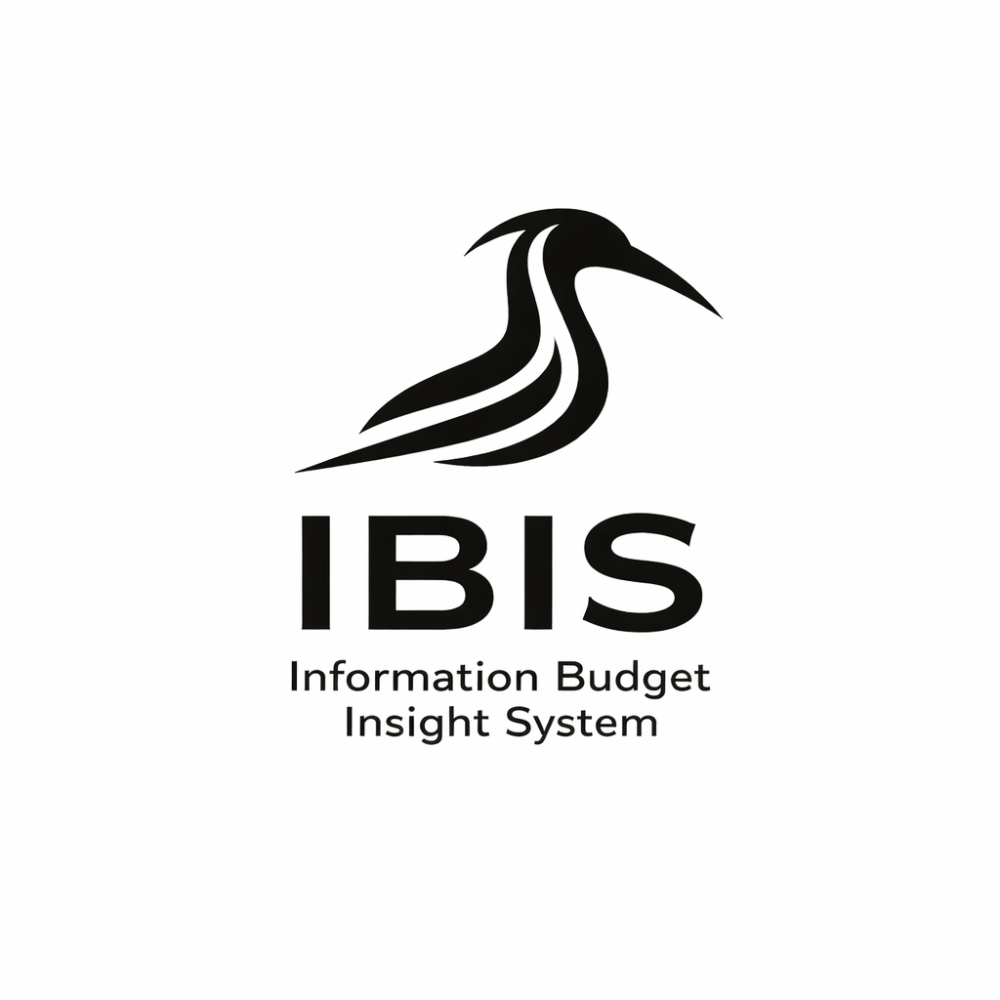

<div align="center">
   
   <br>
</div>

---

IBIS (Information Budget Insight System) is a a web-based portal that aggregates and consolidates data from various institutional source systems and prepares it for reporting. It is currently under active development.

Check out the documentation at <a href="https://coda-oa.github.io/ibis/" target="_blank" rel="noopener noreferrer">https://coda-oa.github.io/ibis/</a> for recent updates.

## Development

We provide a Docker Compose and devcontainer configuration to develop IBIS in a Docker environment. All necessary dependencies will be installed in the devcontainer.

When launching the devcontainer, IBIS will automatically be started at `localhost:8010`.

### Project management

IBIS uses <a href="https://docs.astral.sh/uv/" target="_blank" rel="noopener noreferrer">uv</a> to manage the project and its dependencies.

### Starting the development environment

Start the local container with Docker Compose:

```sh
docker compose -f compose.local.yml up --build
```

The container startup script installs the locked frontend and Python dependencies, then starts Django and Tailwind's watcher. Tailwind rebuilds the stylesheet when templates or CSS sources change. The site is available at `http://localhost:8010`; stop both processes with Ctrl+C.

To build the stylesheet once without starting the watcher, run this inside the container:

```sh
npm run css:build
```

### Pre-commit configuration

IBIS uses a strict `pre-commit` configuration that runs checks before allowing a commit:

1. **Pyrefly** - type checking
2. **ruff** - linting and code style enforcement
3. **djlint** - Django template linting

### Committing

As we use `commitizen` to ensure correct commit formatting, we recommend using its command-line tool to generate the commit message:

```
uv run cz commit
```

## Get in Touch with us! 📬

- **Project Website**: <a href="https://www.tu-braunschweig.de/ub/wir-ueber-uns/projektuebersicht/ibis" target="_blank" rel="noopener noreferrer">The website of the IBIS project</a>
